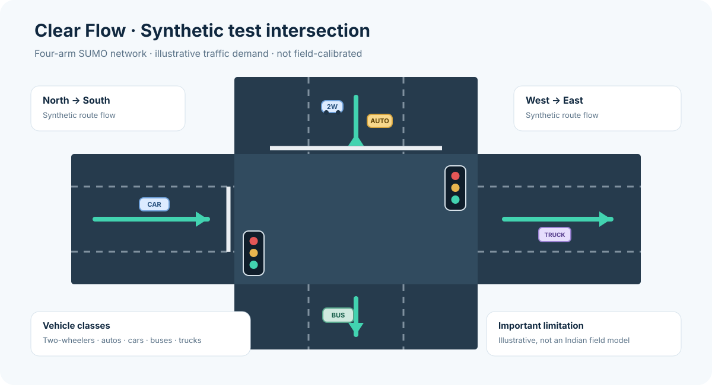
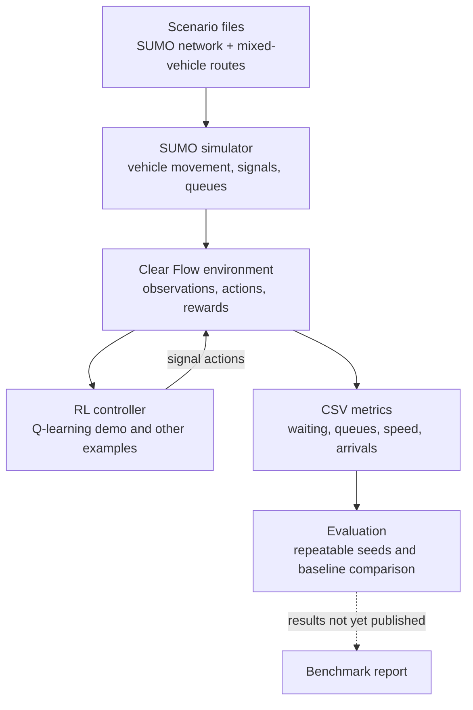

<p align="center">
  
</p>

<h1 align="center">Clear Flow</h1>
<p align="center"><strong>Adaptive traffic-signal research for heterogeneous Indian traffic</strong></p>
<p align="center">
  <a href="https://github.com/envy-ux/Clear-Flow/actions"></a>
  
  
  
</p>

Clear Flow is an open-source research prototype exploring reinforcement-learning approaches to traffic-signal control under **heterogeneous traffic**. It builds on the SUMO-RL framework, uses [SUMO](https://sumo.dlr.de/) for microscopic traffic simulation, and includes a synthetic mixed-vehicle intersection scenario plus an experimental class-weighted congestion reward.

> **Status — v0.1.0:** Clear Flow is for simulation and research, not live traffic control. Its India-themed scenario uses illustrative vehicle and demand parameters; it is not calibrated to a specific city. No real-road deployment, field validation, or measured improvement over a fixed-time controller is claimed in this release.

## Why Clear Flow?

Traffic in many Indian cities includes motorcycles and scooters, auto-rickshaws, cars, buses, and trucks sharing constrained road space. A controller that optimizes only aggregate queues can hide uneven outcomes between vehicle classes or send traffic into a blocked downstream approach.

Clear Flow provides a starting point for experimenting with these questions in simulation. The current scenario is deliberately small so that the model, reward assumptions, and results can be inspected and changed before attempting larger networks.

## At a glance

- **Traffic simulation:** SUMO microscopic simulator and SUMO network/route files.
- **RL interfaces:** Gymnasium-style single-agent and PettingZoo-style multi-agent interfaces inherited from SUMO-RL.
- **Baseline experiments:** Examples for Q-learning, SARSA, DQN, PPO, and optional library integrations, subject to their extra dependencies.
- **Mixed-traffic scenario:** Illustrative vehicle classes for two-wheelers, auto-rickshaws, cars, buses, and trucks.
- **Custom reward:** `clear_flow_mixed_traffic`, a transparent experimental reward incorporating class-weighted waiting, incoming queues, and downstream occupancy.
- **Run metrics:** The example writes per-decision simulation metrics to CSV under `outputs/india-mixed-traffic/`.

## Visual overview

The image below is a **schematic of the bundled synthetic test network**, not a screenshot of a running simulation or a real Indian intersection.

<p align="center">
  
</p>

### Architecture



### Main components

1. **Scenario layer** — `clear_flow/nets/` contains SUMO network and demand files. `clear_flow/nets/india_mixed_traffic/` defines illustrative mixed-vehicle flows.
2. **Simulation layer** — SUMO advances traffic and signal state.
3. **Environment layer** — `clear_flow/` wraps simulator observations, actions, and rewards in RL-friendly interfaces.
4. **Policy layer** — `experiments/` contains example training scripts; `experiments/india_mixed_traffic_qlearning.py` is the Clear Flow mixed-traffic demonstration.
5. **Evaluation layer** — per-decision metrics are saved as CSV so experiments can be inspected and compared. A completed, validated fixed-time-versus-learning benchmark is not included yet.

## Quick start

### 1. Clone the repository

```bash
git clone https://github.com/envy-ux/Clear-Flow.git
cd Clear-Flow
```

### 2. Install SUMO

Install [SUMO](https://sumo.dlr.de/docs/Installing/index.html) separately. The `sumo` binary must be available on your `PATH`; the project also needs `SUMO_HOME` to point to the SUMO installation directory so Python can find SUMO's `tools` folder.

**Windows PowerShell** — replace the example path with the location on your machine:

```powershell
$env:SUMO_HOME = "C:\Program Files (x86)\Eclipse\Sumo"
$env:Path += ";$env:SUMO_HOME\bin"
```

**Linux example** (use the correct path for your distribution):

```bash
export SUMO_HOME=/usr/share/sumo
export PATH="$SUMO_HOME/bin:$PATH"
```

Verify that SUMO is available before continuing:

```bash
sumo --version
```

### 3. Create a Python environment and install Clear Flow

**Windows PowerShell:**

```powershell
py -m venv .venv
.\.venv\Scripts\Activate.ps1
python -m pip install --upgrade pip
python -m pip install -e .
```

**Linux/macOS:**

```bash
python3 -m venv .venv
source .venv/bin/activate
python -m pip install --upgrade pip
python -m pip install -e .
```

If PowerShell blocks environment activation, run `.venv\Scripts\python.exe -m pip install -e .` and use `.venv\Scripts\python.exe` for the commands below. Installing the Python package does **not** install SUMO itself.

### 4. Run the mixed-traffic Q-learning demonstration

From the repository root, with the virtual environment active and `SUMO_HOME` configured:

```bash
python experiments/india_mixed_traffic_qlearning.py --seconds 3600 --seed 42
```

To open the simulation in SUMO-GUI on a desktop installation:

```bash
python experiments/india_mixed_traffic_qlearning.py --seconds 1800 --gui --seed 42
```

Run several independent seeds for exploratory stability checks:

```bash
python experiments/india_mixed_traffic_qlearning.py --seconds 3600 --runs 5 --seed 42
```

The script writes CSV metrics under `outputs/india-mixed-traffic/`. Filenames include a timestamp and run identifier. These outputs are generated locally and are intentionally not committed by default. Training is stochastic; results can vary by seed and configuration.

## Results and benchmark status

**No quantitative performance result is claimed in this repository at present.** The Q-learning script is an experiment entry point, not proof that Clear Flow outperforms fixed-time signals. A benchmark report should be added only after the baseline and learned controller have been run under matched traffic demand and seeds.

| Evaluation item | Current status |
|---|---|
| Mixed-traffic Q-learning run | Runnable experiment script included; numeric results are not committed |
| Fixed-time controller comparison | Not yet measured and reported |
| Multiple-seed aggregate with variance | Not yet reported |
| Outcomes by vehicle class | Not yet reported as a benchmark |
| Calibration to a real Indian junction | Not done |
| Field deployment or operational safety validation | Not done; not a goal of this prototype release |

When reporting results, use the same network, route demand, simulation duration, and seed set for each controller. At minimum, report mean trip duration, average and 95th-percentile waiting time, queue length, completed trips/throughput, and run-to-run variability. Where feasible, report outcomes separately for two-wheelers, auto-rickshaws, cars, buses, and trucks. Do not compare results from mismatched demand or omit runs that performed poorly.

### Evidence to add after running experiments

- Add a real SUMO-GUI screenshot or short recording under `docs/_static/` and link it here. The schematic above should not be presented as a live simulation capture.
- Add a results CSV or small chart generated from repeatable runs, together with the exact command, seeds, SUMO version, Python dependencies, and scenario configuration.
- Populate a fixed-time-versus-Q-learning table only from measured experiments; keep the raw CSVs or provide a reproducible results-generation script.

## What comes from SUMO-RL, and what Clear Flow adds

Clear Flow is a **modified derivative** of [SUMO-RL](https://github.com/LucasAlegre/sumo-rl), not a claim that the entire framework was created from scratch for this repository.

| Area | Origin / status |
|---|---|
| Core SUMO environment, traffic-signal abstractions, and RL API structure | Adapted from SUMO-RL; upstream license and attribution are retained |
| Package and project branding | Updated for Clear Flow (`clear_flow`) |
| Synthetic mixed-vehicle route scenario | Added for this project; parameters are illustrative |
| `clear_flow_mixed_traffic` reward | Added as an experimental, uncalibrated reward function |
| India mixed-traffic Q-learning script | Added as a demonstration built on the environment |
| Multi-intersection coordinated policy, real-world calibration, and validated performance results | Future work; not implemented as completed features in v0.1.0 |

## Project roadmap

- [x] Rebrand the derived framework as Clear Flow and move the Python namespace to `clear_flow`.
- [x] Add an illustrative mixed-vehicle scenario and a class-weighted congestion reward.
- [x] Add a Q-learning demonstration and CSV metric output.
- [ ] Implement a repeatable fixed-time-versus-learning benchmark runner.
- [ ] Add multi-agent coordination experiments across connected intersections.
- [ ] Study spillback, pedestrian constraints, and emergency-vehicle priority with explicit safety constraints.
- [ ] Calibrate vehicle behaviour and demand against documented local traffic observations.
- [ ] Publish benchmark results with seed-level variability and per-vehicle-class analysis.

## Contributing

Contributions should include reproducible evaluation and document assumptions, data sources, and limitations. See [CONTRIBUTING.md](CONTRIBUTING.md) for development and testing instructions, [GITHUB_SETUP.md](GITHUB_SETUP.md) for repository setup, and [SECURITY.md](SECURITY.md) for responsible security reporting.

## License and acknowledgements

The Clear Flow code and inherited SUMO-RL code distributed here are covered by the preserved MIT license and upstream copyright notice. See [`UPSTREAM_NOTICES.md`](UPSTREAM_NOTICES.md) and [`UPSTREAM_CITATION.bib`](UPSTREAM_CITATION.bib) for attribution and citation details.

Some bundled RESCO benchmark assets have separate terms, including Creative Commons notices; review the license files distributed alongside those assets before copying, modifying, or redistributing them. The MIT license for code does not override third-party dataset/network terms. SUMO is a separate project with its own license. Clear Flow is not affiliated with or endorsed by the SUMO developers or any traffic authority.

If you use Clear Flow, cite the software using [`CITATION.cff`](CITATION.cff) and cite the original SUMO-RL work for inherited components.
